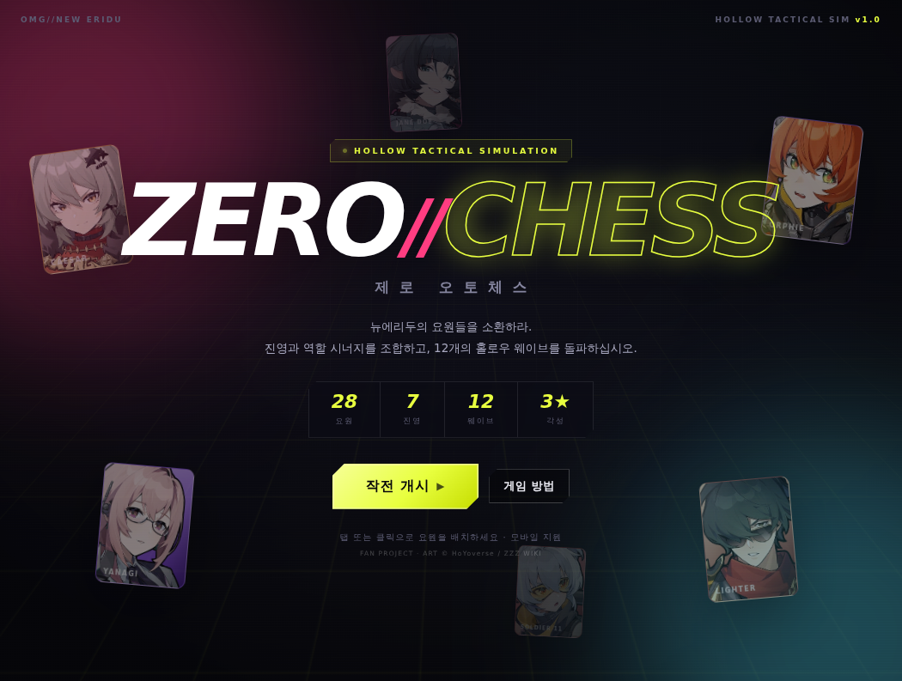
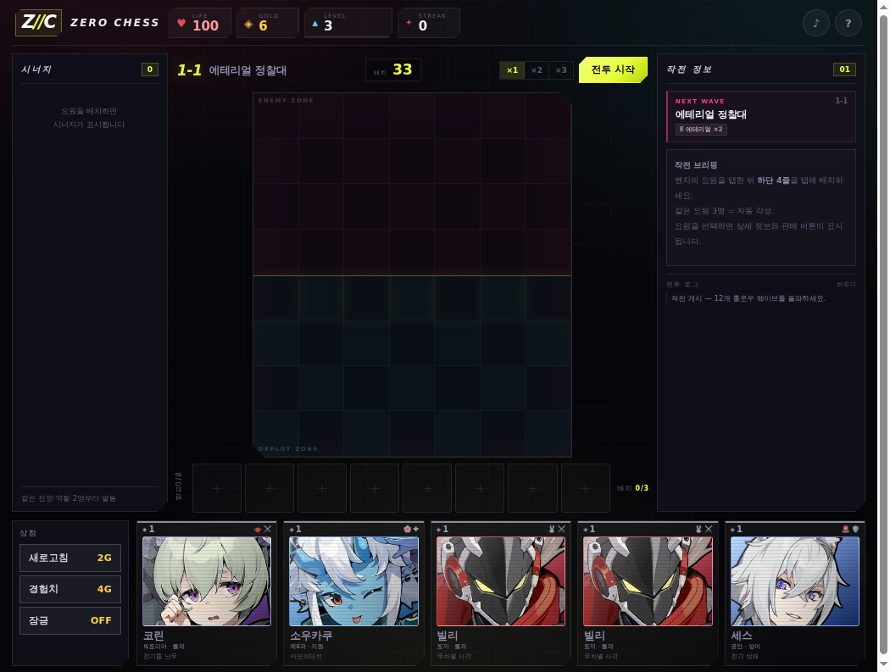
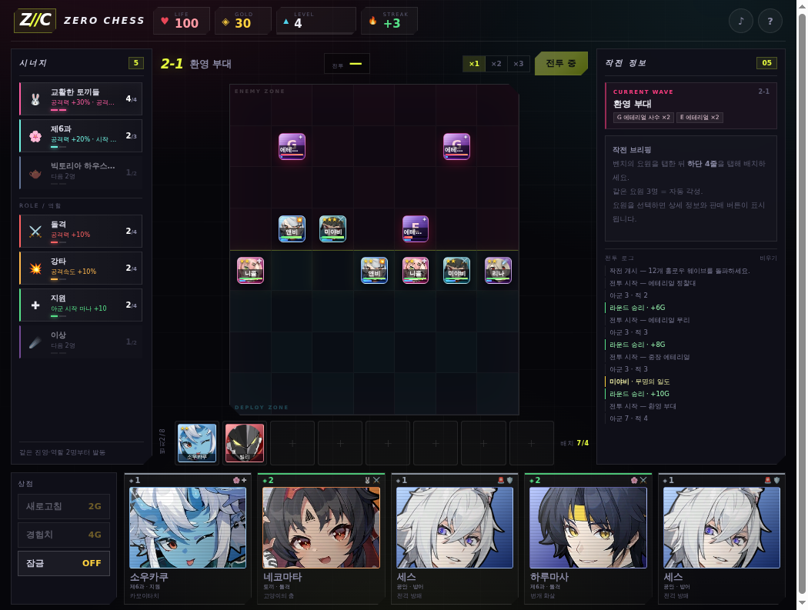
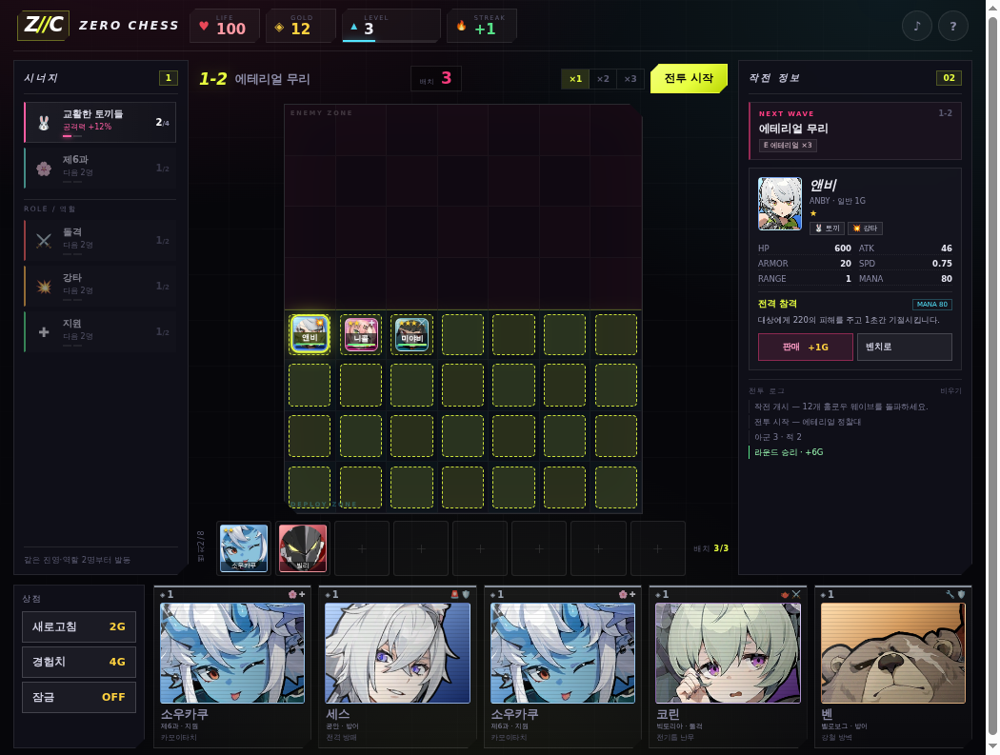
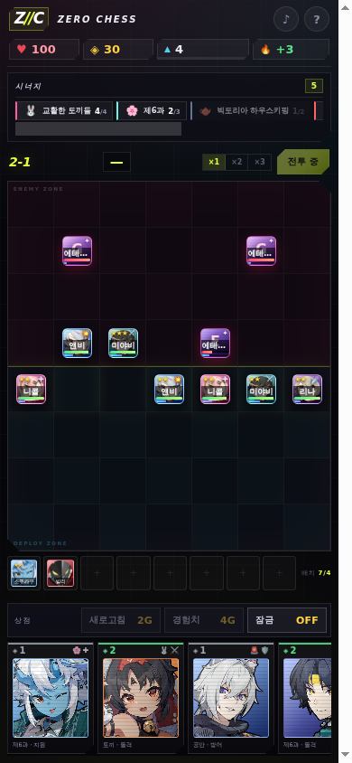

# ZERO//CHESS — 제로 오토체스

젠레스 존 제로(ZZZ) 요원으로 즐기는 팬메이드 **오토배틀러**.
28명의 요원, 7개 진영, 12개의 홀로우 웨이브를 돌파하세요.



## 플레이

별도 빌드 없이 정적 파일만으로 동작합니다.

```bash
python3 -m http.server 3002
# http://localhost:3002
```

- 데스크톱: 클릭 & 드래그, 또는 클릭 → 클릭으로 배치
- 모바일: 탭으로 선택 후 배치, 하단 선택 바에서 판매/이동 지원
- 상점 리롤·잠금, 경험치 구매, 3성 합성, 진영/역할 시너지
- 35초 준비 타이머 후 자동 전투, 12 웨이브 PvE

## 스크린샷

| 상점 & 배치 | 전투 |
| --- | --- |
|  |  |

| 요원 상세 | 모바일 |
| --- | --- |
|  |  |

## 요원 이미지

요원 초상화는 [Zenless Zone Zero Wiki (Fandom)](https://zenless-zone-zero.fandom.com/)에서
내려받아 `assets/agents/`에 로컬 저장했습니다.

- `assets/agents/full/<id>.webp` — 상점 카드/상세/타이틀용 전신 아이콘
- `assets/agents/icon/<id>.webp` — 보드/벤치/전투용 원형 얼굴 아이콘
- 출처 URL: [`assets/agents/sources.txt`](assets/agents/sources.txt)
- 라이선스/저작권: [`assets/agents/CREDITS.md`](assets/agents/CREDITS.md)

이미지가 없거나 로드에 실패하면 이니셜 + 진영 색상으로 자동 대체됩니다.

## 크레딧

비공식 **팬 프로젝트**이며 상업적 목적이 없습니다.
캐릭터 및 이미지 저작권은 **HoYoverse / miHoYo**에 있습니다.
게임에 사용된 요원 아트는 ZZZ Wiki(Fandom)에서 제공되었습니다.

---

<!-- omgithub:readme:start -->
## 🚀 Build, play, and remix with OMGithub

**Created using [OMGithub.com](https://omgithub.com).**

[](https://omgithub.com/kjunburger/PlayGround)
[](https://github.com/kjunburger/PlayGround)

- 🎮 [Open the project](https://omgithub.com/kjunburger/PlayGround).
- ✨ [Remix this project](https://omgithub.com/?remix=kjunburger%2FPlayGround).
- 💻 [Explore the source](https://github.com/kjunburger/PlayGround).
- 🛠️ [Check build runs](https://github.com/kjunburger/PlayGround/actions).
- 🐛 [Report an issue](https://github.com/kjunburger/PlayGround/issues).
- 👤 [Explore the creator's projects](https://omgithub.com/kjunburger).
- 🌍 [Create with OMGithub](https://omgithub.com).
<!-- omgithub:readme:end -->
